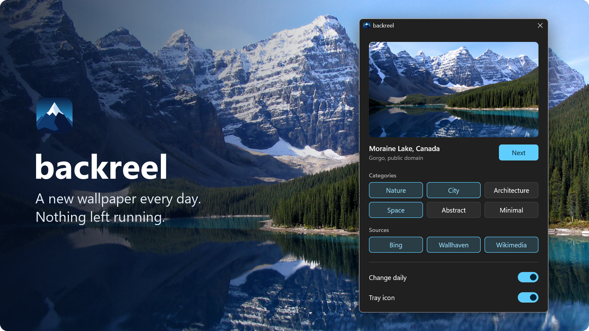
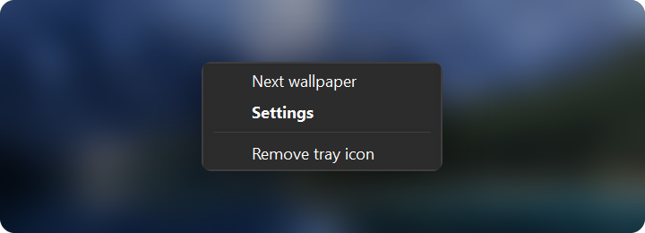
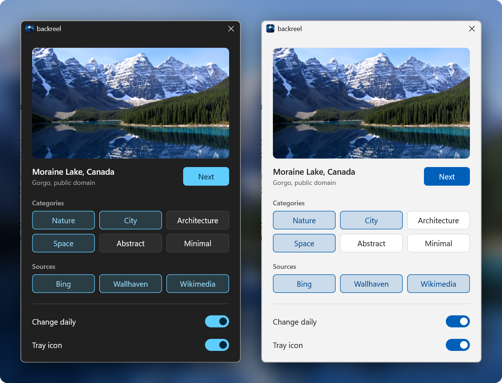

<div align="center">

# backreel

**A new wallpaper every day. Nothing left running.**

Beautiful daily wallpapers for Windows, from the sources and categories you choose,<br>
in a single 515 KB app that uses no memory between changes.




</div>

## Why backreel

- **Three great sources.** Bing's daily photos, Wallhaven's huge community library and Wikimedia's featured pictures.
- **Your taste.** Choose from Nature, City, Architecture, Space, Abstract and Minimal.
- **Sharp on every screen.** Each monitor gets its own image, rendered to its exact resolution.
- **Always fresh.** backreel remembers your last 500 wallpapers and skips them.
- **Practically weightless.** One small file with no background service.

## Get started

You'll need Windows 11 and [Rust](https://rustup.rs). There's no prebuilt download yet.

```
git clone https://github.com/NooberCong/backreel.git
cd backreel
cargo build --release
target\release\backreel.exe
```

Then, in the window that opens:

1. Pick your **categories** and **sources**.
2. Turn on **Change daily**.
3. Turn on **Tray icon** if you'd like quick access.

That's it. backreel installs itself to `%LOCALAPPDATA%\backreel` and adds a Start menu shortcut, so you can delete the build folder.

> [!TIP]
> Quit Microsoft's Bing Wallpaper app if you use it, or it will replace your wallpaper with its own.

## Everyday use



| To | Do this |
|---|---|
| Skip to a new wallpaper | Press **Next**, or right-click the tray icon and choose **Next wallpaper** |
| Open settings | Left-click the tray icon, or find **backreel** in the Start menu |
| See where a photo came from | Click its title in settings |
| Keep the icon in view | Drag it out from behind the `^` next to the clock |

If a day's change fails, for example when you're offline, backreel tries again every hour. On a metered connection, it waits until you're on a free one.

## Looks at home

backreel follows your Windows light or dark theme automatically.



## Light by design

Instead of staying open all day, backreel lets Task Scheduler start it. It sets your wallpaper and exits.

| | Measured |
|---|---|
| Between changes | **0 MB**, no process running |
| Hourly check, once the day's change is done | 1.5 MB, for under 0.1 seconds |
| During a change | About 10 MB, for 1 to 2 seconds a day |
| With the tray icon on | **1.8 MB** of memory, no CPU while idle |
| Settings window | About 16 MB, only while open |
| App size | **515 KB**, with no runtime to install |
| Disk cache | Your last 8 wallpapers, around 7 MB |

## Sources

| Source | Best for | Good to know |
|---|---|---|
| **Bing** | Stunning daily photography | Has no categories, so it ignores your selection |
| **Wallhaven** | The widest choice, in every category | Safe-for-work results only |
| **Wikimedia** | Reviewed, freely licensed photos | Nature and City only, used as a fallback |

Turn Bing off if you'd like every wallpaper to match your categories.

## Good to know

- **Antivirus warnings:** backreel isn't code-signed, so Windows or your antivirus may be cautious about it. You're building it from source, so you can read exactly what it does.
- **Image rights:** Bing's images are for personal, noncommercial use, and Wallhaven's are uploaded by users with unclear rights. Check both before distributing anything.
- **Uninstall:** turn off both switches, then delete `%LOCALAPPDATA%\backreel`.

## For developers

```
cargo test                 # offline
cargo test -- --ignored    # also reaches the real services
```

<details>
<summary>Commands and project layout</summary>

| Command | Effect |
|---|---|
| `backreel` | Open settings |
| `backreel --next` | Change the wallpaper now |
| `backreel --run` | The scheduled job: at most one change a day, skipped on metered networks |
| `backreel --tray` | The tray icon, normally started by its own logon task |
| `backreel --install` / `--uninstall` | Same as the Change daily switch |

| Path | Purpose |
|---|---|
| `src/run.rs` | One wallpaper change: choose, download, render, apply |
| `src/sources/` | One module per image provider |
| `src/desktop.rs`, `imaging.rs`, `http.rs` | Thin wrappers over `IDesktopWallpaper`, WIC and WinHTTP |
| `src/schedule.rs` | Task Scheduler registration, for the daily change and the tray |
| `src/tray.rs` | The tray icon; each action starts the exe as a new process, so it stays small |
| `src/store.rs` | Config, state and log under `%LOCALAPPDATA%\backreel` |
| `src/ui.rs`, `src/ui/` | Settings window, drawn with Direct2D |
| `tools/` | Generators for the app icon and these README images |

Set `BACKREEL_HOME` to keep data in another folder, and `BACKREEL_THEME=light|dark` to override the system theme.

The tray starts from a scheduled task rather than a Run key: Kaspersky flagged an unsigned exe that wrote a Run key and launched a fresh copy of itself as `PDM:Trojan.Win32.Generic`, and froze it.

</details>

---

<sub>Demo wallpaper: [Moraine Lake](https://commons.wikimedia.org/wiki/File:Moraine_Lake_17092005.jpg) by Gorgo, public domain.</sub>
